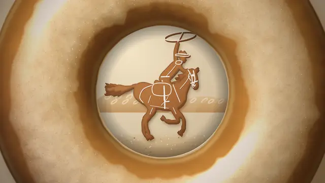
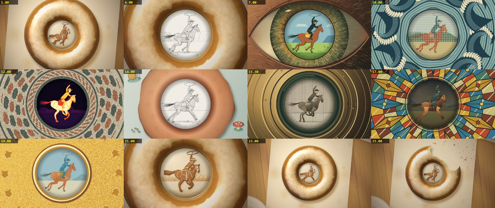
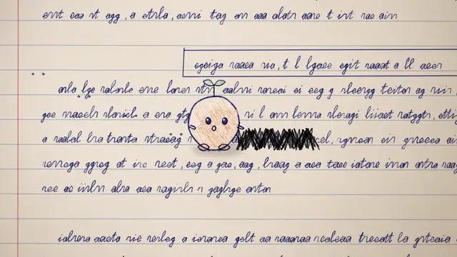
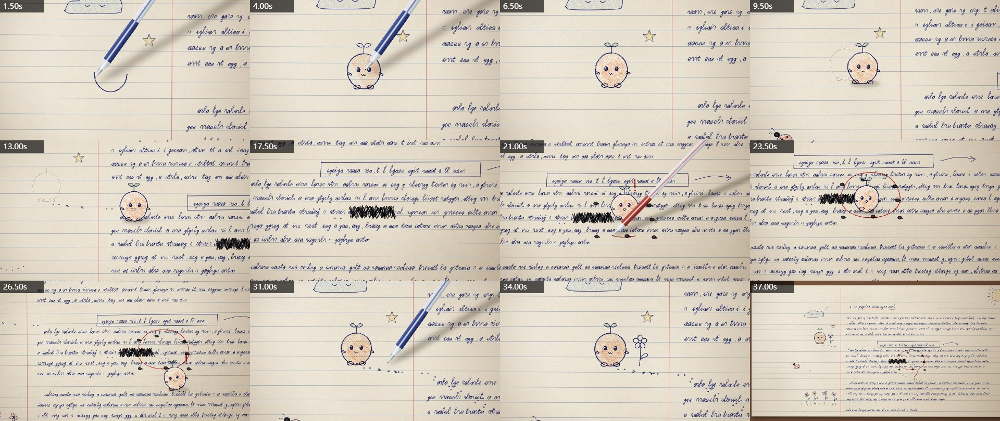

# paint-video

[中文](README.md) | English

A skill that teaches AI agents to paint hand-drawn animated shorts and music videos in code.

Every frame is a pure function of time t. It is painted stroke by stroke, rendered to images in parallel by headless Chrome, and assembled into an MP4 with ffmpeg. There is no AI-generated imagery anywhere in the picture; all of it is drawn by code. The skill holds the whole method for making a film plus the pitfalls we hit along the way, so an agent can go from a one-line request to a finished video.

The skill documents are written in Chinese. Agents read them fine and can reply in any language.

## Films made with it

### *Yikou* (One Bite) · co-point montage

25.8 seconds. A donut fills almost the whole frame, and in its hole a cowboy gallops across the prairie. Every beat the hole switches to a new drawing style, and the ring takes over the style the hole just left, one beat late: pencil sketch, ink wash, woodcut, pop art, oil, pixel art, stained glass, cave painting, blueprint, ukiyo-e, embroidery, watercolor, X-ray, paper cut, oscilloscope, mosaic, thermal camera, crayon, blue-and-white porcelain, rubber hose cartoon, pointillism and clay, 24 styles relayed one after another, while the ring itself turns into a roll of tape, an ink circle, an eye, a rose window. It brakes on Muybridge's galloping horse photograph, returns to the donut, pulls back, and someone takes a bite.

The horse and rider share one anatomical rig that moves through Muybridge's gallop keyframes; each style only decides how to draw it, so the motion never breaks across styles. Frames are drawn with Node and @napi-rs/canvas, no browser. The score is code too: a western gallop with spiccato strings, horn and DRSKit drums, one style per beat. Picture, score and sound effects are in `montage-kit/`.



<details>
<summary>The whole film</summary>



</details>

### *Yebian* (In the Margin) · notebook doodle

38 seconds, one continuous shot. In the margin of a notebook, a blue ballpoint has just drawn a little round creature with a sprout on its head. As soon as the pen lifts, it comes alive: it blinks, steps out of its spot, climbs over the red margin line, hops along the ruled lines into the notes, dives into a scribbled-out word and comes out shaking off ink spots. A red pen circles it, and it pulls the loose end until the red circle comes undone. When it hears the blue pen coming back, it races home along its own footprints and drops into the dent it left behind, perfectly still. The camera pulls back to the whole page, where the footprints, the ink spots and the unravelled red circle are all still there.

The picture is plain 2D canvas: ballpoint lines that skip, colored pencil laid down as diagonal hatching that catches the paper tooth, and the light falloff of a phone photo of a page. A real-looking pen with a shadow draws on the paper, and that alone sells the photo. Living lines wobble 8 times a second; when they stop, the drawing is back on the paper. The score is code too and follows the action: harp for the pen drawing, pizzicato for footsteps, clarinet for its little schemes, and the whole band stops dead when it freezes. Picture and score are in `doodle-kit/`.



<details>
<summary>The whole film</summary>



</details>

### *Shalou* (The Hourglass) · sand animation

75 seconds: a year seen by a grain of sand. In the dark a fingertip draws an hourglass and light comes through its two triangles; the falling sand piles into a mound, which is pressed into a seed; the seed sprouts into a tree made of light; wind drags the canopy into streaks, and the streaks curl into waves; the sea is pulled away, leaving a moon and a few reeds on the shore; falling sand slowly dims the moon while snow comes down row by row; finally a curtain of sand covers everything and the same hourglass is drawn again, so the film loops.

The picture is a WebGL simulation of a layer of sand: pouring, carving with a fingertip, pushing with a palm, slides at the angle of repose and curtains of sand, lit from below with each color channel absorbed separately so thin areas break into single grains. Most of what is drawn is light cleared out of the sand, and every transition is a shape turning into the next one, never a fade. The score is code too and was written to the picture: piano, harp, solo violin, VSCO2 strings, horn and timpani at 60 BPM, one beat per second. Picture and score are in `sand-kit/`.


<details>
<summary>The whole film</summary>


</details>

### *A Drop of Ink* · fluid ink music video

91 seconds of a classical-meets-rock piece, pictured as ink and colored pigment on one sheet of paper. A single drop of ink falls and the violin writes across the page like a pen; at 16 seconds drums and distorted guitars crash in and color bursts out of the ink; every cymbal in the climax blooms in a different way; at the end the color fades back to paper, and another drop of ink falls.

The picture is a WebGL fluid simulation with pigments mixed subtractively by absorbance. Every note of the score pushes the pigment directly: the violin is a pen, the kick is an impact, the cymbal is a bloom, and the chord picks the color. The score is code too: VSCO2 strings and multi-velocity DRSKit drums, rendered as stems and mixed by a small Python mixing desk written for this film. Picture, score, drum sample builder and mixing desk are all in `fluid-kit/`.


<details>
<summary>The whole film</summary>


</details>

### *Far Light* · a printmaking series

93 seconds, no people. Six stages in the journey of one dandelion seed: high summer, looking up, the wind, up high, the far light, and an epilogue. Each stage is printed in a different technique: risograph, copperplate etching, paper marbling, cyanotype, letterpress halftone, and a botanical plate. The horizon and the distant light never move across all six.

The seed and its companions scatter in the wind. It finally lands in the light it once looked up at and finds it is only a lantern; farther off, its companions are each glowing somewhere of their own.

The score is code too: Tone.js with real instrument samples (string sections, solo violin and French horn from VSCO2 Community Edition, plus harp, flute, clarinet, nylon guitar and more), and everything in the picture is timed in musical beats. Picture, score and render scripts are all in `prints-kit/`.


<details>
<summary>The whole film</summary>


</details>

### *Light Switch for the Brain* · science explainer

3 minutes 5 seconds on the 2026 Nobel Prize in Physiology or Medicine: how a pond alga "sees" light, how that light-gated door was put into neurons and became a switch for the brain, and how it later gave a blind patient back part of his sight. Eight scenes in eight styles (underwater microscopy, paper diagrams, Cajal-style ink neurons, fluorescence, a top-down open field, an engraved eye cross-section, a dot-matrix point of view), with subtitles and labels. Sound effects are synthesized in code and the Chinese narration comes from edge-tts; picture, sound and voice share one timeline. The whole film's code is in `explainer-kit/`.


<details>
<summary>The whole film</summary>


</details>

### *Shiquan* (Sparring) · colored ink-wash fight

19.5 seconds, silent, in the colored ink-wash style of *Fog Hill of Five Elements*. A standoff on a cliff, staff meets fist, a duck under a hook into a rising strike that drags the staff along the ground, and a leaping, flaming overhead slam that bursts fire and ink across the screen. Figures are brush-outlined with flat color and a shadow tone; motion runs on smooth curves through the keyframes, and feet are planted step by step so they never slide. Contact points are lined up by computing joint coordinates with a probe. The whole film's code is in `inkfight-kit/`.


<details>
<summary>All shots</summary>


</details>

### *Two Hands* · shadow puppet short

60 seconds, no song. A little general tries to strike his pose, but his arm is yanked around the stage by an extra rod; behind the screen, both rods turn out to be held by the two hands of the same person. Every leather piece is carved with cut-outs and multiplied onto a lamp-lit screen. The clappers, drums, gongs and cymbal crashes are all synthesized with numpy and placed on the beat with the action. The whole film's code, storyboard and synthesizer are in `piying-kit/`.


<details>
<summary>All shots</summary>


</details>

### *Daitouniao* (The Dumb Bird) · crayon picture-book MV

2:29, 36 shots. Oil-pastel crayon with comic-strip panels: a riverside town in southern China from dawn to night, where the boy panics and turns into a round, dumb-looking bird with a *poof*. From script to subtitled final cut in under 2 hours.


<details>
<summary>Whole film at a glance</summary>


</details>

### *Pipa Qu* (Pipa Song) · watercolor MV

2:09, 39 shots. Brush-drawn figures in the style of Feng Zikai, with no facial features; the lantern festival switches to silhouettes against warm light, and the ending pulls back into a hanging scroll.


<details>
<summary>Whole film at a glance</summary>


</details>

### *Luokuan* (The Seal) · ink-wash short

16.8 seconds. A drop of ink blooms into distant mountains; wherever the small red figure walks, reeds and a river get painted in, until it sits down and becomes the seal on the finished painting. Scene code: `examples/brush/ink.js`.


### *Shixing* (Catching Stars) · watercolor short

14.5 seconds, the first test film. Clawd holds an empty jar, catches falling stars, and a jar of starlight slowly warms the night. Scene code: `examples/brush/stars.js`.


The two songs are copyrighted, so this repository contains no audio or lyrics. All previews above are silent; the percussion of *Two Hands* is synthesized, so running `piying-kit/sound/synth.py` regenerates it; the sound and narration of *Light Switch for the Brain* come from `explainer-kit/tools/audio.js` and `tools/voice.js`; the score of *Far Light* is regenerated by `npm run audio` in `prints-kit`; the score of *A Drop of Ink* is regenerated by `npm run stems` and `npm run mix` in `fluid-kit` once the drum samples are downloaded; the scores of *Shalou* and *Yebian* are regenerated by `npm run audio` in `sand-kit` and `doodle-kit`; the score of *Yikou* is regenerated by `npm run audio` in `montage-kit` once the drum samples are installed as described for `fluid-kit`.

## What it teaches the agent

- **Eight rendering engines**
  - Watercolor, ink wash: p5.js + p5.brush, built on [ClaudeAnimationBase](https://github.com/JohnHeibel/ClaudeAnimationBase); speed varies widely with scene complexity.
  - Crayon picture book: a 2D canvas engine written for this repo, `crayon-kit/`, 10–50 ms per frame.
  - Shadow puppets: a 2D canvas engine written for this repo, `piying-kit/`, 2–10 ms per frame, with synthesized percussion.
  - Colored ink-wash fights: a 2D canvas engine written for this repo, `inkfight-kit/`, 20–100 ms per frame.
  - Science explainers: a 2D canvas engine written for this repo, `explainer-kit/`, 60–130 ms per frame, with synthesized sound effects and edge-tts narration.
  - Printmaking series: six print techniques generated as SVG, `prints-kit/`, about 1 s per frame, rendered in parallel.
  - Fluid ink: WebGL2 stable fluids driven by the note list, `fluid-kit/`, about 65 ms per frame, rendered sequentially.
  - Sand animation: a WebGL2 height field of sand with pouring, carving, pushing, slides and curtains, lit from below, `sand-kit/`, about 90 ms per frame and up, rendered sequentially.
  - Notebook doodle: a 2D canvas engine written for this repo, `doodle-kit/`, with ballpoint lines, colored pencil hatching, fake handwriting and a real-looking pen with a shadow; the page is pre-rendered into a texture, 2–10 ms per frame.
  - Co-point montage: `montage-kit/`, two layers relaying drawing styles one beat apart, 24 styles sharing one rig, drawn with Node and @napi-rs/canvas.
- **Writing your own score**: Tone.js with real instrument samples (including VSCO2 orchestral samples) instead of synth tones; three layers, a density curve, a single climax, humanized timing; offline export from headless Chrome with two-pass loudness normalization; picture timed to the beat. For classical-meets-rock pieces: multi-velocity round-robin real drums, stem export, and a home-made mixing desk (EQ, compression, saturation, convolution reverb, per-section loudness matching, limiting).
- **Rules of filmmaking**: one thing for the viewer to watch per shot, cause before reaction; give the audience time to understand; a transition at every seam; no text in the picture; rich but not cheap, no confetti or sparks as filler.
- **A checking loop**: after every shot, render a contact sheet, consecutive frames, and zoomed crops, then look at them with an image viewer. Check for teleporting, floating hands, flipped facing, props covering faces, muddy colors. You cannot tell whether an animation works by reading code.
- **A full music-video workflow**: beat analysis → a shot list written in beat numbers (change the edit in one place) → cheap style tests → a parts library → batches with self-review → targeted reshoots → color grading with ffmpeg.
- **Lyric subtitles**: a separate transparent PNG layer composited on top, vertical text revealed half a line at a time. In the crayon version the text has the same paper grain and jitters with the picture; a *probe* records where characters are actually drawn in every frame so the layout avoids them.
- **A directing handbook**: shot sizes, the 180° line and the 30° rule, where to cut, pause-burst-pause rhythm, composition and eye-trace, character acting, action-scene principles, and a storyboard checklist. Written so that models which only follow instructions can use it too.
- **How to make an explainer**: check the news and the original sources before writing; rules for subtitles, chapter tags and leader-line labels; transitions chosen by content; loudness measured section by section; narration generated line by line, stretching the picture wherever a line runs long, with the background ducking under the voice.
- **A counterexample**: a test film that obeyed every rule and still had no story, with a point-by-point account of why.

## Layout

| Path | Contents |
|---|---|
| `paint-video/` | The skill itself. `SKILL.md` for shorts, `mv-workflow.md` for long films and MVs, `crayon.md` for the crayon style, `piying.md` for shadow puppets, `wushan.md` for colored ink-wash fights, `directing.md` a directing handbook for every style (storyboards, shot sizes, the 180° line, cutting, rhythm, acting), `explainer.md` for science explainers, `prints.md` for the printmaking series, `fluid.md` for fluid ink music videos, `sand.md` for sand animation, `doodle.md` for notebook doodles, `montage.md` for co-point montage, `music.md` for writing your own score |
| `crayon-kit/` | Crayon engine, characters (3-heads-tall figures and the bird), parts library, a 16-second demo, lyric subtitle tools |
| `piying-kit/` | Shadow puppet engine, jointed puppet on rods, the complete code and storyboard of the 60-second *Two Hands*, percussion synthesizer |
| `inkfight-kit/` | Colored ink-wash engine, brush-outlined cel-shaded figure rig, the complete code of the 19.5-second fight *Shiquan*, `probe.mjs` for joint coordinates, a 24-move library `moves.js` (`plan()` chains moves by contact time, with a demo duel) |
| `explainer-kit/` | Explainer engine, the complete code of the 3-minute *Light Switch for the Brain*, the sound synthesizer `tools/audio.js`, the narration script `tools/voice.js` |
| `prints-kit/` | SVG generators for six print techniques, the complete code of the 93-second *Far Light*, its score with offline export, and the parallel render script |
| `fluid-kit/` | WebGL fluid engine, the complete picture code and note list of the 91-second *A Drop of Ink*, its score, the DRSKit sample builder and player, the mixing desk `mixdesk.py` with its config |
| `sand-kit/` | WebGL sand engine, the complete picture code of the 75-second *Shalou*, its score written to picture, and the offline export |
| `doodle-kit/` | 2D canvas engine for ballpoint and colored pencil, the complete picture code and storyboard of the 38-second *Yebian*, its score written to the action, and the offline export |
| `montage-kit/` | Two-layer style relay engine, an anatomical galloping horse rig, 24 drawing styles, the complete code of the 25.8-second *Yikou*, its score and sound effects |
| `examples/brush/` | Scene code for *Shixing* and *Luokuan*; drop into ClaudeAnimationBase to run |
| `tools/` | `analyze.py` for beats and sections, `make_shotlist.py` shot-list template |
| `docs/` | Preview images for the README |

## Install

```bash
git clone https://github.com/nzl153/paint-video-skill
cd paint-video-skill
```

Copy `paint-video/` into your agent's skills directory: `~/.claude/skills/` for Claude Code, `~/.codex/skills/` for Codex. Keep the repository around; the skill looks inside it for `crayon-kit/` and the examples.

Requirements:

- Node 22.12+, Chrome or Chromium, ffmpeg (on PATH)
- The scripts only look for Chrome in the usual install locations; if yours is elsewhere, pass `--chrome=<path>` or set `CHROME_PATH`
- Subtitle tools: Python 3, numpy, Pillow
- Shadow puppet percussion: Python 3, numpy, scipy
- Explainer narration: Python 3 and `pip install edge-tts` (needs access to Microsoft's speech service; set `TTS_PROXY` if you need a proxy)
- Beat analysis: also scipy, matplotlib
- Fluid ink score: Python 3, numpy, scipy; download the drums yourself from [DRSKit 2.1](https://drumgizmo.org/wiki/doku.php?id=kits:drskit) (about 2.6 GB), unpack, and run `python -I tools/drs_build.py <unpacked dir> samples/drs`. Not needed for the picture alone, but re-exporting the note list after editing the score (`npm run events`) needs the drums installed too
- The scores of the prints, fluid, sand, doodle and montage films need a network connection on the first export to download Tone.js and instrument samples from jsDelivr (about 200 MB each for prints and sand), then read them from each kit's `.cache/`
- Watercolor style: also clone [ClaudeAnimationBase](https://github.com/JohnHeibel/ClaudeAnimationBase) and run `npm install`

## Try the crayon demo

```bash
cd crayon-kit
npm install
node render.mjs --sheet=1,4,8,12 --cols=4 --w=480 --out=out/check/sheet.jpg    # contact sheet
node render.mjs --loop=cast --sheet=1 --cols=1 --w=960 --out=out/check/cast.jpg # character sheet
node render.mjs --frames --workers=4                                            # render all frames
node render.mjs --encode --out=out/demo.mp4                                     # encode
```

16 seconds, 384 frames; about 45 seconds with 4 workers.

## Usage

Once installed, just tell the agent what you want, for example:

- "Make a 15-second crayon picture-book short: a puppy chases a falling leaf until it lands on its nose."
- "Make an ink-wash short, about 16 seconds, of a crane stepping out of the paper."
- "Turn this song (audio and LRC lyrics attached) into a landscape music video. Show me the script first."

The agent writes a storyboard for you to review, then builds shot by shot, rendering and checking each one before moving on. For long films it shows you still contact sheets batch by batch and renders motion only after you approve.

## Performance

Measured on an RTX 4060 laptop:

| | Per frame | Example |
|---|---|---|
| Crayon engine | 10–70 ms | 2:29 MV, 3590 frames, about 4 minutes with 4 workers |
| Shadow puppet engine | 2–10 ms | 60 s, 1440 frames, about 2 minutes straight to MP4 with one worker |
| Colored ink-wash fight engine | 20–100 ms | 19.5 s, 468 frames, under 1 minute with 4 workers |
| Explainer engine | 60–130 ms | 3:05, 5550 frames, about 9 minutes straight to MP4 with one worker |
| p5.brush watercolor | about 1 s and up; complex shots are slower | 2:09 MV, 3102 frames, measured at about 1.5–2 hours with 3 workers |
| Fluid ink | about 65 ms | 91 s, 2730 frames, about 3 minutes rendered sequentially in one process |
| Sand animation | about 90 ms; a few hundred ms while the tree grows | 75 s of film plus 3 s of tail, 78 s and 2340 frames in all, about 25 minutes rendered sequentially in one process |
| Notebook doodle | 2–10 ms (about 1 s for the first frame, which builds the page texture) | 38 s, 912 frames, about 40 seconds with 4 workers |
| Co-point montage | about 100 ms | 25.8 s, 774 frames, about 1.5 minutes straight to MP4 with one worker |
| Subtitle layer | — | whole film including compositing, about 3–8 minutes with 6 workers |

## Acknowledgements

- [PDoomVideo](https://github.com/JohnHeibel/PDoomVideo): a two-and-a-half-minute MV generated by Claude in Claude Code, the starting point of this approach (that repository has no license; none of its code is used here).
- [ClaudeAnimationBase](https://github.com/JohnHeibel/ClaudeAnimationBase) (MIT): the p5.brush base; the `render.mjs` of `crayon-kit/`, `piying-kit/` and `inkfight-kit/` is adapted from it.
- [paint-mv-skills](https://github.com/lintsinghua/paint-mv-skills) (MIT): reference for lyric timing and audio analysis.
- [DRSKit](https://drumgizmo.org/wiki/doku.php?id=kits:drskit) (CC BY 4.0, the DrumGizmo team): the drums of *A Drop of Ink*.
- [VSCO 2 Community Edition](https://github.com/sgossner/VSCO-2-CE) (CC0) and [tonejs-instruments](https://github.com/nbrosowsky/tonejs-instruments): orchestral, guitar and bass samples.
- Recommended fonts: [Ma Shan Zheng](https://fonts.google.com/specimen/Ma+Shan+Zheng), [Long Cang](https://fonts.google.com/specimen/Long+Cang), [Zhi Mang Xing](https://fonts.google.com/specimen/Zhi+Mang+Xing), all OFL, download them yourself.

## License

MIT, see [LICENSE](LICENSE).
