# paint-video

中文 | [English](README.en.md)

让 AI agent 用代码画手绘动画短片和 MV 的 skill。

每一帧都是时间 t 的纯函数：用笔刷一笔一笔画出来，无头 Chrome 并行渲染成图片，ffmpeg 合成 MP4。画面里没有一张 AI 生图，全是代码画的。skill 里写的是做片子的整套方法和踩过的坑，agent 读了就能从一句话需求做到成片。

## 用它做的片子

### 《沙漏》· 沙画短片

75 秒，一粒沙看见的一年。黑场里一根手指划出一只沙漏，光从两个三角里透出来；沙漏下来堆成一座丘，被按成一颗种子，破土长成一棵光做的树；风把树冠拖成流线，流线卷成浪；浪退下去，留下一轮月亮和岸边几株芦苇；月亮被落下的沙慢慢吃暗，雪一排排往下落；最后一道沙帘把一切盖住，同一只沙漏又被划出来，首尾相接。

画面是 WebGL 模拟的一层沙：撒、指尖划、手掌推、休止角滑落、沙帘，底光按三个通道分别透过沙层，薄处是一粒一粒的。画出来的东西大多是「清出来的光」，每一次转场都靠形状接上，没有淡入淡出。配乐也是代码写的，照着画面写：钢琴、竖琴、独奏小提琴、VSCO2 弦乐、圆号、定音鼓，60 拍每分钟，一拍对一秒。画面和配乐都在 `sand-kit/`。


<details>
<summary>全片一览</summary>

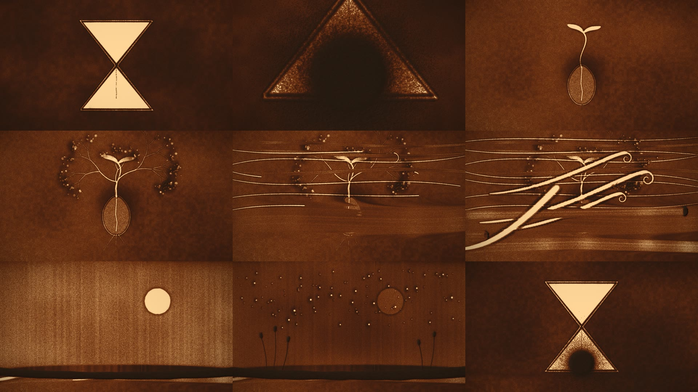

</details>

### 《一滴墨》· 流体彩墨 MV

91 秒，一首古典 + 摇滚的曲子，画面是一张纸上的墨和彩墨。开头一滴墨落下，小提琴像一支笔在纸上写；第 16 秒鼓和失真吉他砸进来，颜色从墨里炸开；高潮每一记镲都换一种开花方式；最后颜色褪回纸色，又是一滴墨。

画面是 WebGL 流体模拟，颜料按吸光度叠色。曲子里的每个音符都直接推动颜料：小提琴是笔，底鼓是冲击，镲是开花，和弦决定颜色。配乐也是代码写的：VSCO2 弦乐、DRSKit 多力度真鼓，分轨后过一个自己写的 Python 混音台。画面、乐谱、鼓采样整理脚本和混音台都在 `fluid-kit/`。

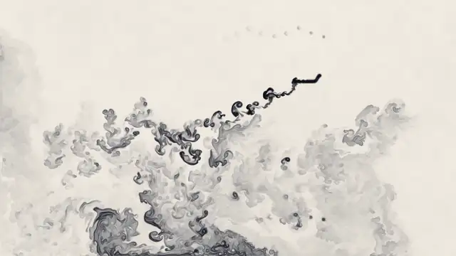

<details>
<summary>全片一览</summary>

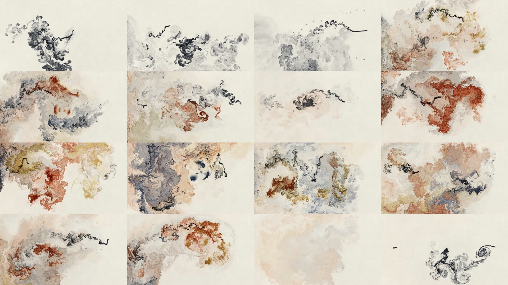

</details>

### 《远光》· 版画系列短片

93 秒，不出现人。一颗蒲公英种子的六段旅程：盛夏、仰望、风起、高处、远光、尾声。每段换一种版画工艺：孔版套印、铜版蚀刻、大理石纹染纸、蓝晒、凸版网点、植物图版。地平线和远处那盏光六段都不动。

种子和伙伴们在风里各奔东西。它落进当年仰望的那盏光里，才发现那只是一盏灯；更远处，伙伴们各自亮着。

配乐也是代码写的：Tone.js 加真乐器采样（弦乐组、独奏小提琴、圆号来自 VSCO2 社区版，另有竖琴、长笛、单簧管、尼龙弦吉他等），画面的一切按乐谱的拍子对齐。整部片子的画面、配乐和渲染脚本都在 `prints-kit/`。

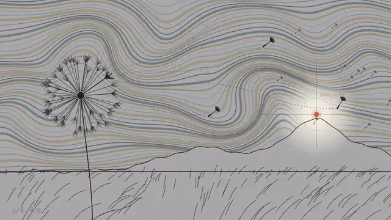

<details>
<summary>全片一览</summary>

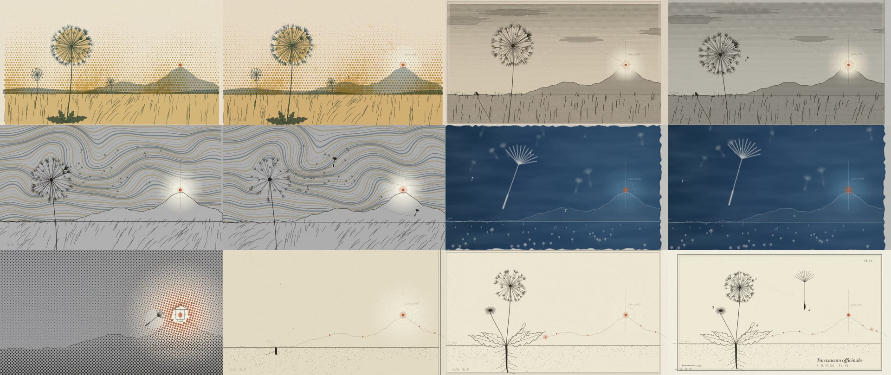

</details>

### 《用光，打开大脑》· 科普讲解片

3 分 05 秒，讲 2026 年诺贝尔生理学或医学奖：池塘里的绿藻怎么「看见」光，这扇光控的门怎样被装进神经元，变成控制大脑的开关，最后让盲人部分恢复视觉。八场八种画风（显微水下、纸面图示、卡哈尔墨线、荧光显微、俯视旷场、铜版画剖面、点阵视角），字幕和标注齐全；声效全部代码合成，旁白用 edge-tts，三者共用一条时间轴。整部片子的代码在 `explainer-kit/`。

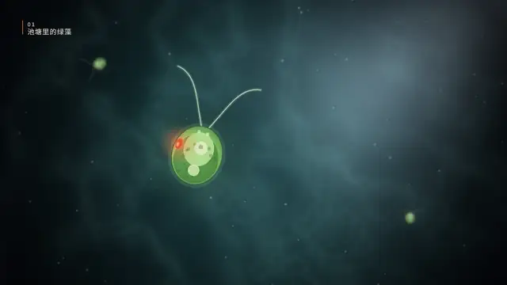

<details>
<summary>全片一览</summary>

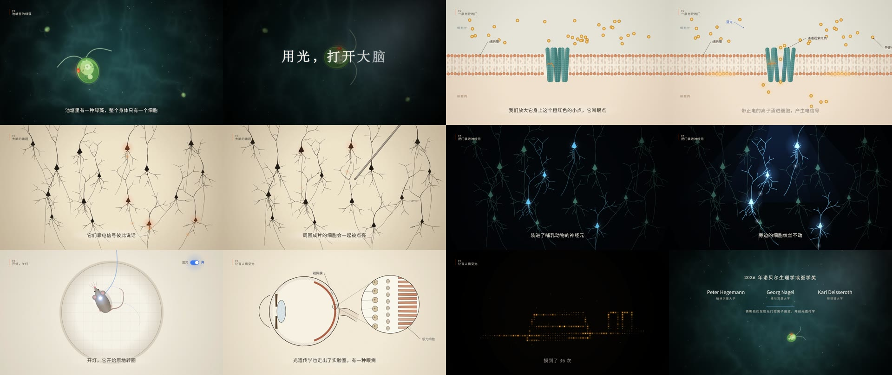

</details>

### 《试拳》· 设色水墨打斗

19.5 秒，无声，雾山五行那一路的设色水墨。崖顶对峙，棍拳相撞，矮身钻过勾拳、拖棍擦地上挑，最后跃起抡棍带火砸下，火墨炸满屏。人物是毛笔勾线加平涂和暗面，动作走穿过关键帧的平滑曲线，脚一步一步踩实不打滑；接触点用探针算坐标对准。整部片子的代码在 `inkfight-kit/`。

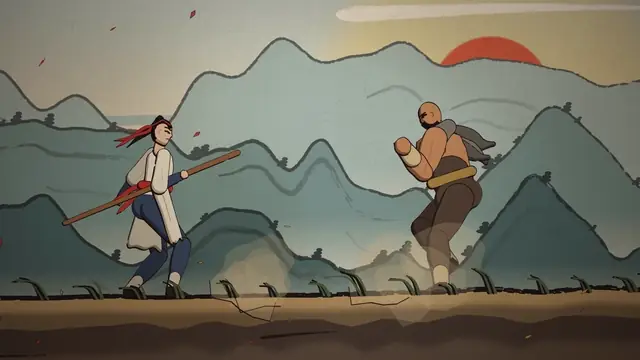

<details>
<summary>全片一览</summary>

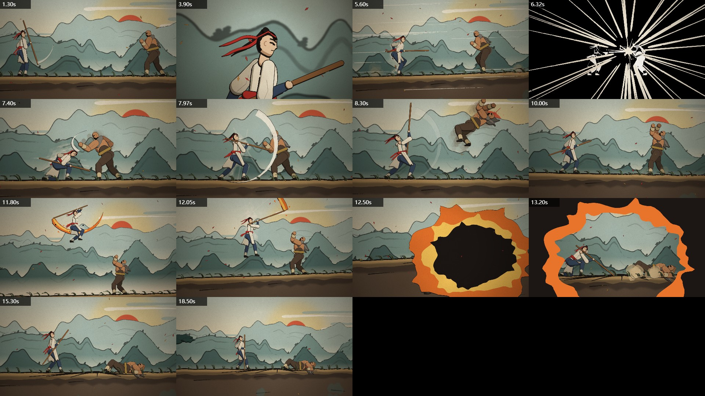

</details>

### 《两只手》· 皮影短片

60 秒，没有歌。小将军要亮相，胳膊却被另一根杆子拽着满台跑；绕到幕后一看，两根杆子握在同一个人的两只手里。每片皮单独刻好镂空，再叠到透光的幕上；梆子、碎鼓、小锣、「锵」全部用 numpy 合成，按拍号和动作对齐。整部片子的代码、分镜和合成器都在 `piying-kit/`。

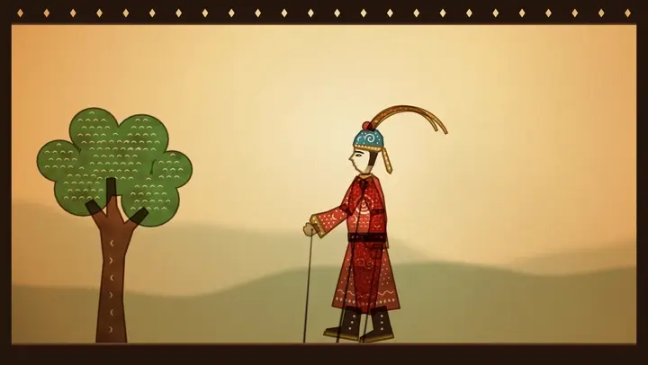

<details>
<summary>全片一览</summary>

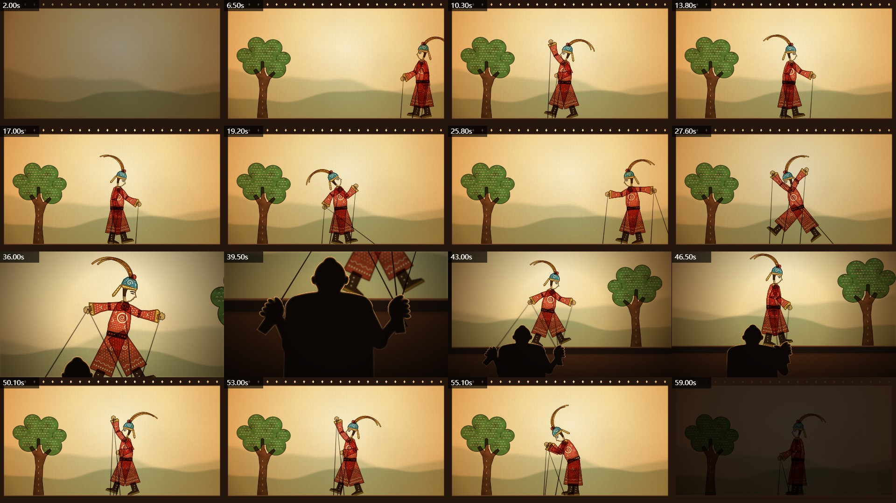

</details>

### 《呆头鸟》· 蜡笔绘本 MV

2 分 29 秒，36 个镜头。油画棒蜡笔加连环画分格，江南小镇从清晨到夜里，男主一慌就「噗」地变成一只呆头鸟。从剧本到带字幕的成片不到 2 小时。

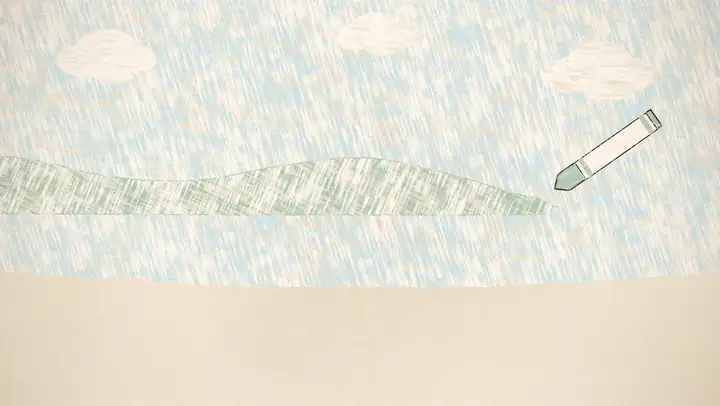

<details>
<summary>全片一览</summary>

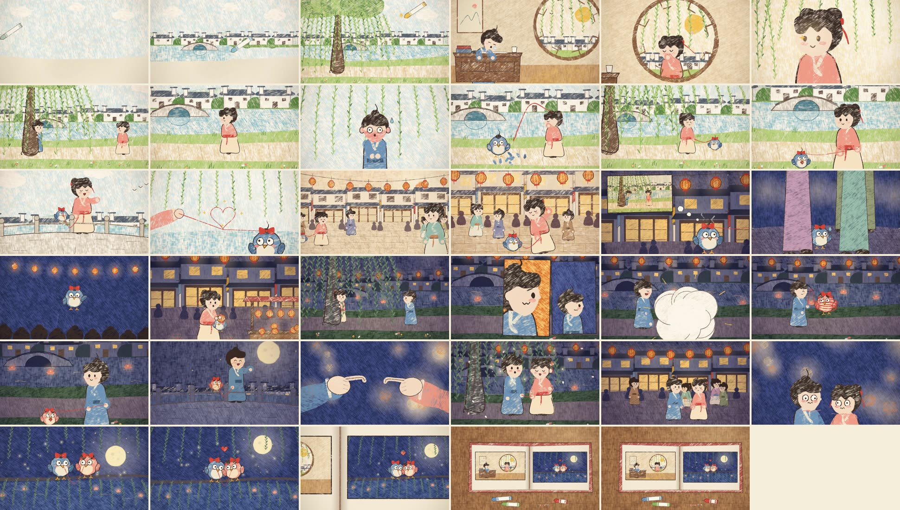

</details>

### 《琵琶曲》· 水彩 MV

2 分 09 秒，39 个镜头。丰子恺式的笔刷小人，不画五官；灯会一段换成剪影配暖光，结尾拉远成一幅画卷。

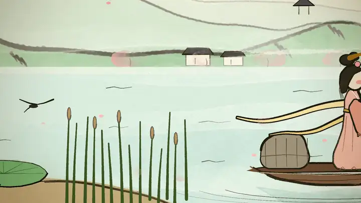

<details>
<summary>全片一览</summary>

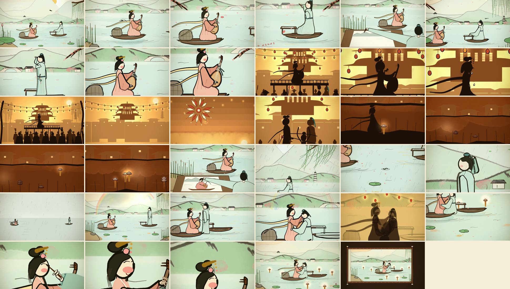

</details>

### 《落款》· 水墨短片

16.8 秒。一滴墨落成远山，小红块走到哪里，芦苇和河就画到哪里，最后坐下成了整幅画的印。场景代码在 `examples/brush/ink.js`。


### 《拾星》· 水彩短片

14.5 秒，第一支测试片。Clawd 捧着空罐子接住掉下来的星星，一罐星光把夜色一点点焐暖。场景代码在 `examples/brush/stars.js`。


两部 MV 的歌有版权，仓库里不带音频和歌词。上面的预览都是无声画面；《两只手》的锣鼓是合成的，跑一下 `piying-kit/sound/synth.py` 就能生成；《用光，打开大脑》的声效和旁白分别跑 `explainer-kit/tools/audio.js`、`tools/voice.js` 生成；《远光》的配乐跑 `prints-kit` 里的 `npm run audio` 生成；《一滴墨》的配乐按 `fluid-kit` 的说明下好鼓采样后，跑 `npm run stems` 和 `npm run mix` 生成；《沙漏》的配乐跑 `sand-kit` 里的 `npm run audio` 生成。

## 它教给 agent 什么

- **八套制作引擎**
  - 水彩、水墨、版画：p5.js + p5.brush，基于 [ClaudeAnimationBase](https://github.com/JohnHeibel/ClaudeAnimationBase)，速度随镜头复杂度波动较大。
  - 蜡笔绘本：本仓库自写的 2D canvas 引擎 `crayon-kit/`，每帧 10–50ms。
  - 皮影：自写的 2D canvas 引擎 `piying-kit/`，每帧 2–10ms，锣鼓用代码合成。
  - 设色水墨打斗：自写的 2D canvas 引擎 `inkfight-kit/`，每帧 20–100ms。
  - 科普讲解片：自写的 2D canvas 引擎 `explainer-kit/`，每帧 60–130ms，声效代码合成，旁白 edge-tts。
  - 版画系列：SVG 生成的六种版画工艺 `prints-kit/`，每帧约 1 秒，多路并行渲染。
  - 流体彩墨：WebGL2 稳定流体 `fluid-kit/`，音符表直接驱动颜料，每帧约 65ms，只能顺序渲染。
  - 沙画：WebGL2 沙子高度场 `sand-kit/`，撒、划、推、休止角、沙帘，底光透沙，每帧约 90ms 起，只能顺序渲染。
- **自己写配乐**：Tone.js 加真乐器采样（含 VSCO2 真管弦乐），不用合成音色；三层编曲、密度曲线、全曲只留一个高点、人性化；无头 Chrome 离线导出、两遍响度标准化；画面按拍子对齐。古典 + 摇滚的曲子另有多力度轮换的真鼓、分轨导出和一个自写的混音台（均衡、压缩、饱和、卷积混响、按段对齐响度、限幅）。
- **导演手册**：景别、轴线和 30 度规则、剪辑点、「停、爆、停」的节奏、构图和视线、角色表演、动作戏原则，最后是一张分镜检查表。写给只会照指令做的模型也能用。
- **做片子的规矩**：每个镜头只让观众看一件事、先有原因再有反应；给「看懂」留时间；每个接缝都有转场；画面不写字；丰富但不廉价，不撒火花填空。
- **检查循环**：每做完一个镜头就渲出联系表、连续帧、局部放大图，用读图工具自己看，查瞬移、悬空的手、朝向、道具挡脸、颜色发脏。只读代码看不出动画好不好。
- **整首歌的 MV 流程**：节拍分析 → 用拍号写逐镜表（改剪辑只改一处）→ 先便宜地试风格 → 零件库 → 分批做、每批自检 → 局部返修 → ffmpeg 调色。
- **歌词字幕**：单独一层透明 PNG 叠上去，竖排、按半句出。蜡笔版的字也有纸纹、会随画面抖动；用「探针」记下每帧人物实际画在哪里，自动排版避开人物。
- **科普片的做法**：先查新闻和原文核对事实；字幕、章节、引线标注的规矩；转场跟着内容选；声效按段量响度；旁白逐句生成，读得长就把那一段画面拉长，人声一响背景自动避让。
- **反面教材**：一支规矩全守却没戏的测试片，逐条写了为什么没戏。

## 目录

| 路径 | 内容 |
|---|---|
| `paint-video/` | skill 本体。`SKILL.md` 短片入门，`mv-workflow.md` 长片与 MV 流程，`crayon.md` 蜡笔画风，`piying.md` 皮影，`wushan.md` 设色打斗，`directing.md` 导演手册（分镜、景别、轴线、剪辑、节奏、表演，各画风通用），`explainer.md` 科普讲解片，`prints.md` 版画系列，`fluid.md` 流体彩墨 MV，`sand.md` 沙画，`music.md` 自己写配乐 |
| `crayon-kit/` | 蜡笔引擎、角色（3 头身小人和呆头鸟）、零件库、16 秒 demo、歌词字幕工具 |
| `piying-kit/` | 皮影引擎、带操纵杆的关节小人、60 秒短片《两只手》全部代码和分镜、锣鼓合成器 |
| `inkfight-kit/` | 设色水墨引擎、勾线平涂的人体骨架、19.5 秒打斗短片《试拳》全部代码、算关节坐标的 `probe.mjs`、24 招的招式库 `moves.js`（`plan()` 按接触时刻拼招，附一段示范对打） |
| `explainer-kit/` | 科普片引擎、3 分钟科普片《用光，打开大脑》全部代码、声效合成器 `tools/audio.js`、旁白脚本 `tools/voice.js` |
| `prints-kit/` | 六种版画工艺的 SVG 生成、93 秒短片《远光》全部代码、配乐乐谱与离线导出、并行渲染脚本 |
| `fluid-kit/` | WebGL 流体引擎、91 秒 MV《一滴墨》全部画面代码和音符表、乐谱、DRSKit 真鼓整理脚本和播放器、混音台 `mixdesk.py` 及配置 |
| `sand-kit/` | WebGL 沙画引擎、75 秒短片《沙漏》全部画面代码、照画面写的配乐和离线导出 |
| `examples/brush/` | 《拾星》《落款》的场景代码，放进 ClaudeAnimationBase 就能跑 |
| `tools/` | `analyze.py` 节拍与段落分析，`make_shotlist.py` 拍号逐镜表模板 |
| `docs/` | README 用的预览图 |

## 安装

```bash
git clone https://github.com/nzl153/paint-video-skill
cd paint-video-skill
```

把 `paint-video/` 复制到 agent 的 skills 目录：Claude Code 是 `~/.claude/skills/`，Codex 是 `~/.codex/skills/`。仓库本身留着，skill 会去里面找 `crayon-kit/` 和范例。

需要：

- Node 22.12+、Chrome 或 Chromium、ffmpeg（在 PATH 里）
- 脚本只在常见安装位置找 Chrome，装在别处时传 `--chrome=<路径>` 或设环境变量 `CHROME_PATH`
- 字幕工具：Python 3、numpy、Pillow
- 皮影锣鼓合成：Python 3、numpy、scipy
- 科普片旁白：Python 3、`pip install edge-tts`（要能连上微软语音服务，必要时设 `TTS_PROXY`）
- 节拍分析：再加 scipy、matplotlib
- 流体彩墨的配乐：Python 3、numpy、scipy；鼓采样要自己下 [DRSKit 2.1](https://drumgizmo.org/wiki/doku.php?id=kits:drskit)（约 2.6 GB），解压后跑 `python -I tools/drs_build.py <解压目录> samples/drs`。只看画面不用下
- 水彩画风：另外 clone [ClaudeAnimationBase](https://github.com/JohnHeibel/ClaudeAnimationBase) 并 `npm install`

## 先跑一下蜡笔 demo

```bash
cd crayon-kit
npm install
node render.mjs --sheet=1,4,8,12 --cols=4 --w=480 --out=out/check/sheet.jpg    # 联系表
node render.mjs --loop=cast --sheet=1 --cols=1 --w=960 --out=out/check/cast.jpg # 人设表
node render.mjs --frames --workers=4                                            # 渲全部帧
node render.mjs --encode --out=out/demo.mp4                                     # 合成
```

16 秒 384 帧，4 个进程约 45 秒渲完。

## 怎么用

装好之后直接跟 agent 说要什么，比如：

- 「用蜡笔绘本风格做一支 15 秒的短片：小狗追着一片落叶跑，最后叶子落在它鼻子上。」
- 「做一支水墨短片，16 秒左右，一只鹤从画纸里走出来。」
- 「这首歌（附音频和 LRC 歌词）做成一支横屏 MV，先给我剧本。」

agent 会先写分镜给你看，再一个镜头一个镜头地做，每个镜头渲出来自己检查过才往下走。长片会分批给你看静帧拼图，你点头了再渲动态。

## 性能参考

RTX 4060 笔记本上实测：

| | 每帧 | 例子 |
|---|---|---|
| 蜡笔引擎 | 10–70ms | 2:29 的 MV 共 3590 帧，4 进程约 4 分钟 |
| 皮影引擎 | 2–10ms | 60 秒 1440 帧，单进程直出 MP4 约 2 分钟 |
| 设色打斗引擎 | 20–100ms | 19.5 秒 468 帧，4 进程不到 1 分钟 |
| 科普片引擎 | 60–130ms | 3:05 共 5550 帧，单进程直出 MP4 约 9 分钟 |
| p5.brush 水彩 | 约 1 秒起，复杂镜头更慢 | 2:09 的 MV 共 3102 帧，3 进程实测约 1.5–2 小时 |
| 流体彩墨 | 约 65ms | 91 秒 2730 帧，单进程顺序渲染约 3 分钟 |
| 沙画 | 约 90ms，长树那段几百毫秒 | 78 秒 2340 帧，单进程顺序渲染约 25 分钟 |
| 字幕层 | — | 整片 6 进程加合成约 3–8 分钟 |

## 致谢

- [PDoomVideo](https://github.com/JohnHeibel/PDoomVideo)：Claude 在 Claude Code 里生成的两分半 MV，这套路线的起点（该仓库无许可证，本仓库没有使用它的代码）。
- [ClaudeAnimationBase](https://github.com/JohnHeibel/ClaudeAnimationBase)（MIT）：p5.brush 底座，`crayon-kit/`、`piying-kit/`、`inkfight-kit/` 的 `render.mjs` 由它改来。
- [paint-mv-skills](https://github.com/lintsinghua/paint-mv-skills)（MIT）：歌词对时和音频分析的参考。
- [DRSKit](https://drumgizmo.org/wiki/doku.php?id=kits:drskit)（CC BY 4.0，DrumGizmo 团队）：《一滴墨》的鼓。
- [VSCO 2 Community Edition](https://github.com/sgossner/VSCO-2-CE)（CC0）和 [tonejs-instruments](https://github.com/nbrosowsky/tonejs-instruments)：管弦乐和吉他、贝斯采样。
- 字体推荐 [马善政楷书](https://fonts.google.com/specimen/Ma+Shan+Zheng)、[龙藏体](https://fonts.google.com/specimen/Long+Cang)、[志莽行书](https://fonts.google.com/specimen/Zhi+Mang+Xing)，都是 OFL，需自行下载。

## 许可

MIT，见 [LICENSE](LICENSE)。
